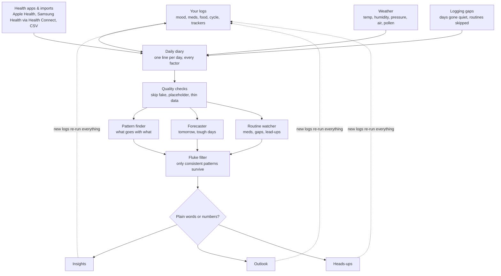

# How SpikeyProfile turns your data into insights

Everything below runs on the phone. Nothing is sent anywhere except an approximate location (rounded to about 10 km) to the weather service, and only if weather is switched on.

## The steps in plain words

1. **Daily diary** (`core/analytics/dailyFeatures.ts`). Every source becomes one line per day: symptom check-ins (averaged if you log more than once), sleep, each medication and quick-log button, exercise, food and drink, substances, focus sessions, tasks done, calendar busyness, your own trackers, cycle position, weather, and anything synced or imported from health apps.
2. **Quality checks.** The old sample entries and the all-5s quick-tap check-in are ignored. A day counts as "didn't do it" only if you used the app that day; days you didn't open the app are unknown, not zero. Anything with fewer than 14 days of data, or that barely changes, is left out.
3. **Pattern finder** (`correlations.ts`). Every factor is compared with every symptom, on the same day and the next day, using rank correlation (Spearman). Sleep the following night is checked too.
4. **Fluke filter.** With hundreds of comparisons, some would look meaningful by luck, so a false-discovery correction (Benjamini–Hochberg, 10%) keeps only the consistent ones. Related measures (for example all the air-pressure readings) are reported once.
5. **Forecaster** (`forecast.ts`, `toughDay.ts`). A small ridge regression per symptom predicts today or tomorrow from yesterday, last night's sleep, the calendar and the weather forecast. It's only used if it beat your own simple averages on your past days; otherwise the app says it's showing your usual level.
6. **Routine watcher** (`medications.ts`, `engagement.ts`, `adherenceDrift.ts`). The app learns when you usually log things, notices quiet spells, and checks what tends to come before them (period, heavier days, busy days, feeling good). Because quiet spells are rare, these use permutation tests, which stay honest with small numbers.
7. **Plain words or numbers.** Every result has a plain sentence and a numbers version; "Show the numbers" in Settings (or on the Insights screen) switches between them.

## How it was checked

`npm test` runs the engine on made-up data with known effects planted in it (for example "short sleep lowers energy" or "going quiet around the start of a period"). The tests check that the planted effects are found, and that **nothing** is reported when the data is pure noise or the gaps are random.
